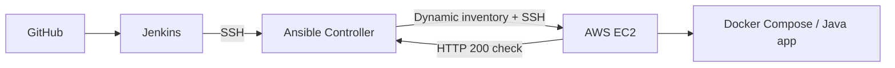

# TWN DevOps Bootcamp — Capstone 05

## Jenkins Integration with Ansible

**Status:** ✅ Jenkins automated deployment pipeline verified — **Build #7**, 22 October 2026  
**Validated revision:** `0e91d7aabd9cd1d6a79729cd5279dbe97b379e0f`  
**Scope:** TechWorld with Nana (TWN) AI-Enhanced DevOps Bootcamp practical project.

### Overview

This project automates deployment of an existing **Docker Compose Java application** onto a selected **AWS EC2** instance through **GitHub → Jenkins → Ansible**. Jenkins checks out Git-controlled infrastructure code, transfers a versioned release to a dedicated Ansible controller, validates it, deploys with reusable roles, and verifies the application's HTTP response.



### Technologies

Git · GitHub · Jenkins Pipeline/Groovy · Ansible Core 2.16.3 · Ansible Vault · AWS EC2 dynamic inventory · Amazon Linux 2023 · SSH · Docker Compose · Java · MySQL

### Documentation

| Document | Description |
| --- | --- |
| [Architecture](docs/architecture.md) | System components, trust boundaries and architecture diagrams |
| [Use cases](docs/use-cases.md) | Actors, scenarios, acceptance criteria and failure cases |
| [Pipeline](docs/pipeline.md) | Pipeline stages, versioned releases and CI/CD sequence |
| [Security](docs/security.md) | SSH, Vault, network rules and explicit lab limitations |
| [Operations](docs/operations.md) | Workflow, troubleshooting and recovery boundaries |
| [Validation & evidence](docs/validation.md) | Build #7 results, test checklist and portfolio evidence |

### Repository structure

```text
.
├── Jenkinsfile                   # Short pipeline entry point
├── jenkins/
│   └── capstone05.groovy         # Project-local pipeline implementation
├── ansible/
│   ├── deploy-application.yml
│   ├── deploy-docker-new-user.yaml
│   ├── inventory_aws_ec2.yaml
│   ├── ec2-docker-vars.yaml
│   └── roles/                    # Eight reusable Ansible roles
├── docs/                         # Architecture, use cases, runbooks and evidence
└── README.md
```

### Verified result

Jenkins job `TWN-Capstone-05-Ansible-Jenkins` completed **Build #7** with `Finished: SUCCESS`. The final remote Ansible HTTP check returned **200 OK** from `http://127.0.0.1:8080/` on the targeted EC2 host. The full deployment `PLAY RECAP` should still be retained separately as evidence; the shared excerpt covered the health check and final pipeline outcome.

### Security and scope

The target is limited to a single EC2 instance; SSH host-key validation is enforced; the EC2 key and encrypted Vault remain on the Ansible controller. There is **no manual approval gate** in this controlled training pipeline. No production-hardening, database backup platform, Terraform deployment, or multi-instance rollout is claimed. See [Security](docs/security.md) for risks and deferred work.

---

*Part of the TechWorld with Nana DevOps Bootcamp portfolio.*
