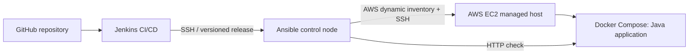

# Capstone 05 — Ansible Integration in Jenkins

**TechWorld with Nana · Module 15 · Two-EC2 deployment verified**

## Objective

Integrate Ansible with a Jenkins CI/CD pipeline to configure AWS EC2 application hosts and automate deployment from a separate Ansible control node. This repository contains the verified Jenkins–Ansible training implementation managing **two** EC2 instances.

## Architecture

[Architecture and responsibilities](docs/architecture.md).

## Implementation

- Jenkins retrieves version-controlled playbooks and delegates execution to the Ansible controller.
- Ansible selects two approved EC2 instances through AWS dynamic inventory and an explicit two-host limit.
- Reusable roles deploy the existing Docker Compose application.
- A final HTTP request from the EC2 host verifies the application response.

**Source:** [`Jenkinsfile`](Jenkinsfile), [Groovy pipeline](jenkins/capstone05.groovy), [Ansible playbook](ansible/deploy-application.yml), [roles](ansible/roles/).

## Validation

| Item | Recorded result |
|---|---|
| Jenkins job | `TWN-Capstone-05-Ansible-Jenkins` |
| Pipeline | **Build #8: SUCCESS** (25 October 2026) |
| Tested revision | `c8885feaa0afdf669271b35f70870412adff3ff1` |
| Remote application check | **HTTP 200 on both instances** |
| Complete Ansible `PLAY RECAP` evidence | **Build #8 captured and summarized** |
| Two managed EC2 instances from TWN example | **Verified in Jenkins Build #8** |
| Official TWN review | Not verified |

The two-host Ansible PLAY RECAP was `ok=13 changed=0 unreachable=0 failed=0` on each host. This demonstrates successful, idempotent reconciliation of **already installed** applications, not fresh provisioning or database migration. See [Build #8 evidence](evidence/jenkins-build-08-two-ec2-2026-10-25.md).

## Documentation

[Architecture](docs/architecture.md) · [Pipeline](docs/pipeline.md) · [Validation evidence](docs/validation.md) · [Operations](docs/operations.md) · [Security notes](docs/security.md)

**Security boundary:** SSH identity and Vault data stay outside Git; host-key verification is enforced in the tested workflow. This is a training deployment, not a production HA system. Do not publish credentials, logs containing secrets or internal infrastructure details.

**TWN submission:** [`main` branch](https://github.com/asambataiden/twn-capstone-05-ansible-jenkins/tree/main), subject to reviewer access and secret/history review.
