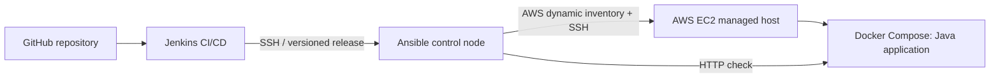

# Capstone 05 — Ansible Integration in Jenkins

**TechWorld with Nana · Module 15 · Implementation demonstrated**

## Objective

Integrate Ansible with a Jenkins CI/CD pipeline to configure AWS EC2 application hosts and automate deployment from a separate Ansible control node. This repository contains the working single-target training implementation; the TWN example also describes configuring **two** EC2 managed instances.

## Architecture

[Architecture and responsibilities](docs/architecture.md).

## Implementation

- Jenkins retrieves version-controlled playbooks and delegates execution to the Ansible controller.
- Ansible selects the intended EC2 instance through AWS dynamic inventory and an explicit host limit.
- Reusable roles deploy the existing Docker Compose application.
- A final HTTP request from the EC2 host verifies the application response.

**Source:** [`Jenkinsfile`](Jenkinsfile), [Groovy pipeline](jenkins/capstone05.groovy), [Ansible playbook](ansible/deploy-application.yml), [roles](ansible/roles/).

## Validation

| Item | Recorded result |
|---|---|
| Jenkins job | `TWN-Capstone-05-Ansible-Jenkins` |
| Pipeline | **Build #7: SUCCESS** (22 October 2026) |
| Tested revision | `0e91d7aabd9cd1d6a79729cd5279dbe97b379e0f` |
| Remote application check | **HTTP 200** |
| Complete Ansible `PLAY RECAP` evidence | **Not yet archived** |
| Two managed EC2 instances from TWN example | **Not demonstrated** (single deployment target) |
| Official TWN review | Not verified |

The final HTTP check and Jenkins success are recorded in the project validation notes; they do not independently prove every previous playbook task or database operation.

## Documentation

[Architecture](docs/architecture.md) · [Pipeline](docs/pipeline.md) · [Validation evidence](docs/validation.md) · [Operations](docs/operations.md) · [Security notes](docs/security.md)

**Security boundary:** SSH identity and Vault data stay outside Git; host-key verification is enforced in the tested workflow. This is a training deployment, not a production HA system. Do not publish credentials, logs containing secrets or internal infrastructure details.

**TWN submission:** [`main` branch](https://github.com/asambataiden/twn-capstone-05-ansible-jenkins/tree/main), subject to reviewer access and secret/history review.
