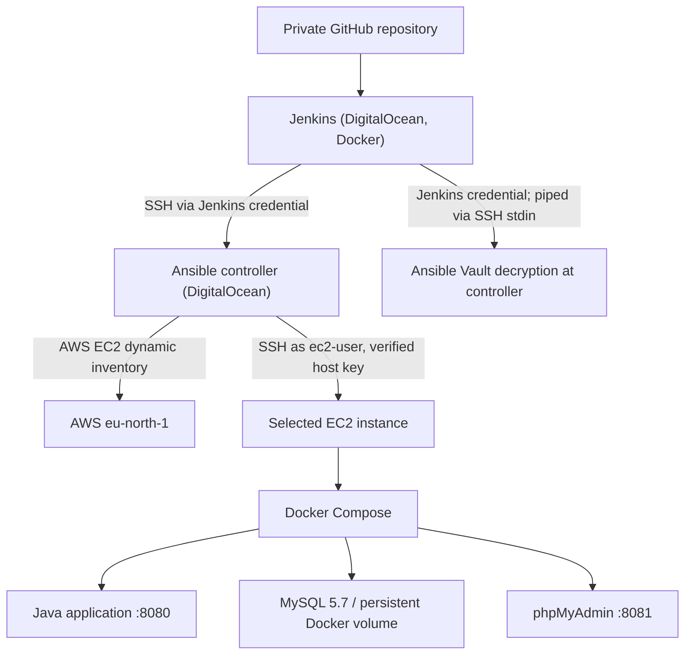

# TWN DevOps Bootcamp — Capstone 05

## Jenkins Integration with Ansible: Automated Deployment to AWS EC2

**Status:** Automated deployment pipeline verified — Jenkins Build **#7**, 22 October 2026.  
**Repository:** `asambataiden/twn-capstone-05-ansible-jenkins`  
**Validated source revision:** `0e91d7aabd9cd1d6a79729cd5279dbe97b379e0f`  
**Scope:** TechWorld with Nana (TWN) DevOps Bootcamp practical capstone, not a production-ready multi-tenant platform.

### 1. Objective

Demonstrate a Git-driven Jenkins pipeline that transfers a versioned Ansible release to a dedicated Ansible controller, deploys an existing Docker Compose application to a selected Amazon Linux EC2 instance, and verifies application availability over HTTP.

Learning outcomes:
- Connect Jenkins securely to a remote Ansible controller.
- Discover AWS EC2 hosts dynamically using the `amazon.aws.aws_ec2` inventory plugin.
- Use reusable Ansible roles and Ansible Vault without committing secrets.
- Deploy from a traceable Git revision, targeting one EC2 instance using `--limit`.
- Validate deployment using container/service checks and an HTTP `200` response.
- Capture Jenkins logs and Git revisions as reproducible lab evidence.

### 2. Architecture



The application health check runs **on the EC2 host** against `http://127.0.0.1:8080/`; EC2 security-group ingress does not need to expose port 8080 to the internet for this test.

### 3. Technology

| Layer | Technology |
| --- | --- |
| Source control | Git / private GitHub repository |
| CI/CD | Jenkins LTS, Declarative Pipeline, project-local Groovy module |
| Controller automation | Ansible Core 2.16.3 |
| AWS inventory | `amazon.aws` collection 7.2.0; dynamic EC2 discovery |
| Managed hosts | AWS EC2, Amazon Linux 2023, SSH user `ec2-user` |
| Application runtime | Docker Engine, Docker Compose v2 |
| Sample stack | Java Maven application, MySQL 5.7, phpMyAdmin |
| Credential handling | Jenkins Credentials, Ansible Vault, SSH host-key verification |

Versions are those observed in the bootcamp environment; review compatibility before rebuilding on newer hosts or collections.

### 4. Repository layout

```text
.
├── Jenkinsfile                         # Small Declarative Pipeline entry point
├── jenkins/
│   └── capstone05.groovy               # Project-local Jenkins Pipeline steps
├── ansible/
│   ├── deploy-docker-new-user.yaml     # Initial host setup and deployment
│   ├── deploy-application.yml          # Application-only redeployment
│   ├── inventory_aws_ec2.yaml          # AWS dynamic inventory
│   ├── ec2-docker-vars.yaml            # Non-secret configuration
│   └── roles/
│       ├── linux_baseline/
│       ├── docker_storage/
│       ├── docker_engine/
│       ├── linux_users/
│       ├── docker_compose/
│       ├── docker_registry/
│       ├── application_deploy/
│       └── application_verify/
└── README.md
```

Existing introductory/local-lab files may also be present. The `jenkins/capstone05.groovy` file is **loaded with Jenkins' `load` step**; it is not a separately configured global Jenkins Shared Library.

### 5. Pipeline flow

1. **Checkout** — Jenkins checks out the configured Git branch/revision.
2. **Validate Source** — Require expected playbooks, inventory, role task files, and absence of a plaintext Vault file.
3. **Verify Ansible Controller** — Connect using Jenkins-managed SSH credential `ansible-server-key`.
4. **Transfer Versioned Release** — Create `git archive HEAD`, transfer the archive over SSH, and unpack into a unique release directory on the controller.
5. **Validate Ansible Release** — Run `ansible-playbook --syntax-check` using the controller's Vault file and Jenkins-managed Vault password.
6. **Verify EC2 Connectivity** — Run `ansible.builtin.ping` against the selected AWS instance using verified host keys and the controller's EC2 private key.
7. **Deploy Application** — Run `deploy-application.yml` against **one** inventory host via `--limit`, reusing `application_deploy` and `application_verify` roles.
8. **Verify Application HTTP** — Run `ansible.builtin.uri` from EC2 to `http://127.0.0.1:8080/`, requiring `status_code=200`.

The pipeline proceeds automatically after validation; **there is no manual approval step**. The Jenkins job must therefore be restricted to trusted users and trusted branch changes.

### 6. Required controller-side prerequisites

The remote Ansible controller retains the following **outside the repository**:

- `/root/ansible-jenkins-key-pair.pem` — EC2 SSH private key (never commit or print).
- `/root/.ssh/known_hosts_capstone05` — independently verified EC2 SSH host keys.
- `/root/secrets.vault.yml` — encrypted Ansible Vault variables, including MySQL credentials.
- Ansible Core and required collections (`amazon.aws`, `community.docker`).
- AWS authentication capable of describing tagged EC2 instances in `eu-north-1`.

In Jenkins, configure `ansible-server-key` (SSH credential for the Ansible controller), `ansible-vault-password` (secret text), and a GitHub credential for the private repository.

The controller's inventory group `ec2_docker_server` selects EC2 instances using the `Role=docker-server` tag. The versioned inventory uses `tags.Role` for compatibility with `amazon.aws 7.2.0`.

### 7. Deployment target and application

The lab limits deployment to the first EC2 instance:

```text
ec2-16-171-181-122.eu-north-1.compute.amazonaws.com
```

The application is installed at `/opt/twn-demo-app` on that instance. The application-specific playbook checks for an existing Docker Compose deployment and the `twn-demo-app_mysql-data` volume before calling the application roles. A separate `my-mysql` container and its `ec2-user_mysql-data` volume are outside this deployment's scope.

The supplied Compose template runs the public Java image `asambataiden/demo-app:java-maven-2.0`, MySQL 5.7, and phpMyAdmin. The application role may update Compose files and recreate affected containers when desired state changes. Do not assume that a successful HTTP response validates database contents.

### 8. Validation and evidence

**Observed:** Jenkins job `TWN-Capstone-05-Ansible-Jenkins`, **Build #7**, 22 October 2026, checked out Git revision `0e91d7aabd9cd1d6a79729cd5279dbe97b379e0f` and finished with `SUCCESS`.

The shared Jenkins console excerpt confirms:
- Strict EC2 SSH options were set, including `ANSIBLE_PRIVATE_KEY_FILE` and `UserKnownHostsFile`.
- `ansible.builtin.uri` returned `status: 200`, `changed: false`, `msg: OK (215 bytes)`.
- The pipeline ended with `SUCCESS: Jenkins-Ansible deployment verified.` and `Finished: SUCCESS`.

The complete `Deploy Application` task output and Ansible `PLAY RECAP` were **not included** in that shared excerpt. Preserve the full Jenkins Build #7 console log as deployment evidence; do not infer individual `changed` counts or database state from the HTTP result alone.

Suggested evidence to retain privately: Jenkins Stage View/Pipeline Graph, full Build #7 console output (redacted), Ansible deployment recap, and the corresponding Git commit URL. Avoid uploading passwords, private keys, Vault plaintext, private host logs, or live tokens.

### 9. Security decisions and lab limitations

- **SSH verification:** Explicit `StrictHostKeyChecking=yes` and controller-maintained `known_hosts`; Jenkins-to-controller SSH also verifies its host key.
- **Restricted ingress:** The AWS security group shared by both EC2 instances permits port 22 from the Ansible controller's `46.101.229.169/32`, not `0.0.0.0/0`; both targets returned `pong` after restriction.
- **Credentials:** Jenkins supplies the Vault passphrase at execution time; the encrypted Vault file and EC2 SSH key remain on the controller.
- **Controlled blast radius:** Deploy step uses a single explicit EC2 host `--limit`.
- **Known tradeoffs:** Jenkins currently executes on its controller/container; the Docker socket mounting and some lab components need hardening before production use. `mysql:5.7` is end-of-life, and Compose exposes phpMyAdmin/Java ports on the instance network interfaces even though the inspected AWS security group does not permit inbound access to these ports.
- **Existing Git history:** A separate, previously public training repository contained exposed registry credentials. Revoke/rotate those credentials; removing a secret from a later repository does not undo prior exposure.
- **Out of scope:** Database backup automation, Terraform conversion, multi-instance rollout, Jenkins agent redesign, and a production-grade security platform.

### 10. Troubleshooting learned during the capstone

| Symptom | Cause / corrective action |
| --- | --- |
| `Could not match supplied host pattern: ec2_docker_server` | Inventory discovery worked but the custom group was absent. Use `tags.Role` in the versioned inventory with the controller's `amazon.aws 7.2.0`. |
| `Permission denied (publickey,...)` from EC2 | Release-local Ansible execution did not inherit the EC2 private-key configuration. Explicitly set `ANSIBLE_PRIVATE_KEY_FILE`, `ANSIBLE_REMOTE_USER`, and strict SSH arguments. |
| `config file = None` from release directory | Configuration is not implicitly loaded from `/root/ansible.cfg`; connection variables are explicitly supplied by the pipeline. |
| `discovered_interpreter_python: /usr/bin/python3.9` | Informational interpreter discovery warning on Amazon Linux 2023; the HTTP check succeeded. |
| Pipeline waits for `input()` | Earlier draft had manual approval; the final lab pipeline intentionally omits the approval stage. |

### 11. Completion criteria

- [x] Jenkins checkout and source verification
- [x] Versioned Git archive transferred to Ansible controller
- [x] Ansible syntax validation and AWS inventory discovery
- [x] Secure SSH connectivity to target EC2
- [x] Jenkins-driven application workflow with successful Build #7
- [x] HTTP 200 application verification
- [ ] Attach or archive full deployment recap/screenshots for portfolio evidence
- [ ] Review and merge the feature-branch pull request

---

*Created as part of the TechWorld with Nana AI-Enhanced DevOps Bootcamp — Capstone 05.*
