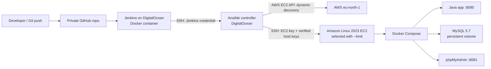

# Architecture — Capstone 05

## Purpose and scope

This document describes the **observed TWN bootcamp laboratory**, not a generalized production architecture. Jenkins triggers Ansible on a dedicated remote controller, which deploys and checks a Java application on a selected AWS EC2 instance.

## Context diagram

## Component responsibilities

| Component | Responsibility | Trust boundary |
| --- | --- | --- |
| GitHub | Stores Jenkinsfile, Groovy module, playbooks, role templates and non-secret variables | No Vault plaintext or private keys |
| Jenkins | Checks out Git revision, validates project, opens SSH session to controller, supplies Jenkins-managed credentials | Jenkins access and branch permissions control automatic deployment |
| Ansible controller | Stores EC2 SSH private key, verified known_hosts, encrypted Vault, AWS inventory access; runs Ansible Core 2.16.3 | Secrets do not belong in Git |
| AWS inventory | Discovers running instances tagged `Role=docker-server`; constructs `ec2_docker_server` group | AWS read access required; explicit `--limit` narrows execution |
| EC2 | Hosts existing Docker Compose application; runs verification module against `127.0.0.1:8080` | Shared security group restricts SSH to controller CIDR |
| Docker Compose | Runs Java app, MySQL and phpMyAdmin | Manifest changes can recreate containers |

## Deployment boundary

1. Jenkins executes `git archive HEAD` for the Ansible source.
2. The archive is unpacked to `/root/twn-capstone-05/releases/<revision>-<build>/` on the Ansible controller.
3. The existing controller-side Vault file is linked into the release; Git does not contain that file.
4. The pipeline validates inventory/connectivity and runs `deploy-application.yml` with a specific `--limit` hostname.
5. The Ansible playbook runs the existing `application_deploy` and `application_verify` roles and checks HTTP 200.

## Design choices

- **Project-local Groovy module**, loaded with Jenkins `load`, keeps `Jenkinsfile` short; it is not a globally installed Jenkins Shared Library.
- **Separate infrastructure and application playbooks** avoid reprovisioning OS and Docker for routine redeployments.
- **Dynamic discovery + static deployment limit** allows reuse while keeping the first execution on a single EC2.
- **Health checked locally on EC2** avoids opening application ingress just for the bootcamp verification.
- **No manual approval**: the controlled Jenkins lab automatically deploys after validations pass.

## Known limitations

- This is a bootcamp lab; Jenkins controller execution, Docker socket access and long-lived root controller SSH warrant additional hardening for production.
- MySQL 5.7 is end-of-life. Database migration/backup automation and multi-instance rolling deployments are outside Capstone 05.
- A successful HTTP check proves availability at the tested endpoint, not correctness of database data or business behavior.
- The separate `my-mysql` container is outside the application Compose project and should not be touched by the capstone deployment.

See [Use cases](use-cases.md), [Pipeline](pipeline.md), and [Security](security.md).
