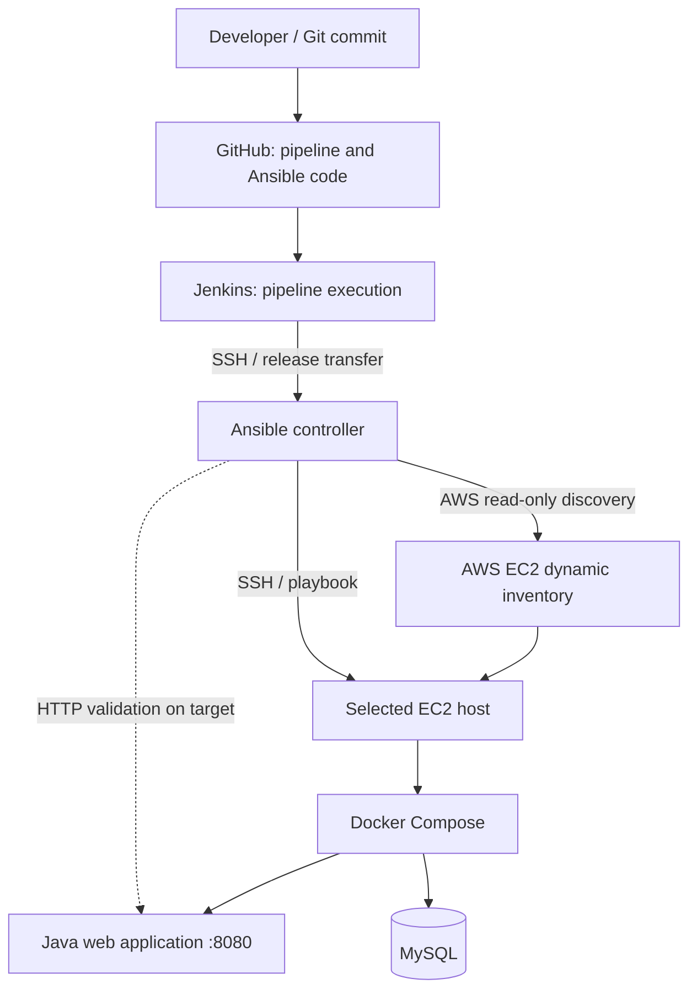

# Architecture — Capstone 05

## Objective

Connect Jenkins to a dedicated Ansible control node and deploy an existing Java/Docker Compose application to AWS EC2. The tested lab targets **one instance**; the official TWN capstone example includes two managed EC2 instances.

## Deployment architecture

## Responsibilities and execution flow

| Component | Role |
|---|---|
| GitHub | Version-controlled Jenkinsfile, Groovy, playbooks and roles; **no plaintext secrets** |
| Jenkins | Checks out a revision, transfers a release and starts remote Ansible execution |
| Ansible control node | Maintains SSH identity, Vault material and dynamic AWS inventory |
| EC2 managed host | Receives application configuration and runs Docker Compose |
| HTTP verification | Confirms the application responds **200** after deployment |

1. Jenkins checks out and packages the selected revision.
2. Jenkins transfers it over SSH to a revision-specific location on the controller.
3. Ansible validates inventory and runs the deployment playbook against the explicitly selected EC2 instance.
4. Application validation checks HTTP on the managed host.

## Security and scope

- Separate Jenkins and Ansible control/managed-host roles; restrict SSH access and validate host keys.
- Use Jenkins credentials and Ansible Vault; never commit private SSH keys or Vault plaintext.
- Dynamic inventory uses EC2 tags but the playbook selects an explicit single target.
- The lab includes older MySQL 5.7 dependencies, not a production database lifecycle.
- Ansible `PLAY RECAP` and a successful two-EC2 deployment are **not** currently evidenced in this portfolio.
- No Terraform provisioning, multi-node application rollout or production-grade HA is claimed.

## Evidence

[Pipeline stages](pipeline.md) · [Build #7 verification](validation.md) · [Operational guidance](operations.md).
