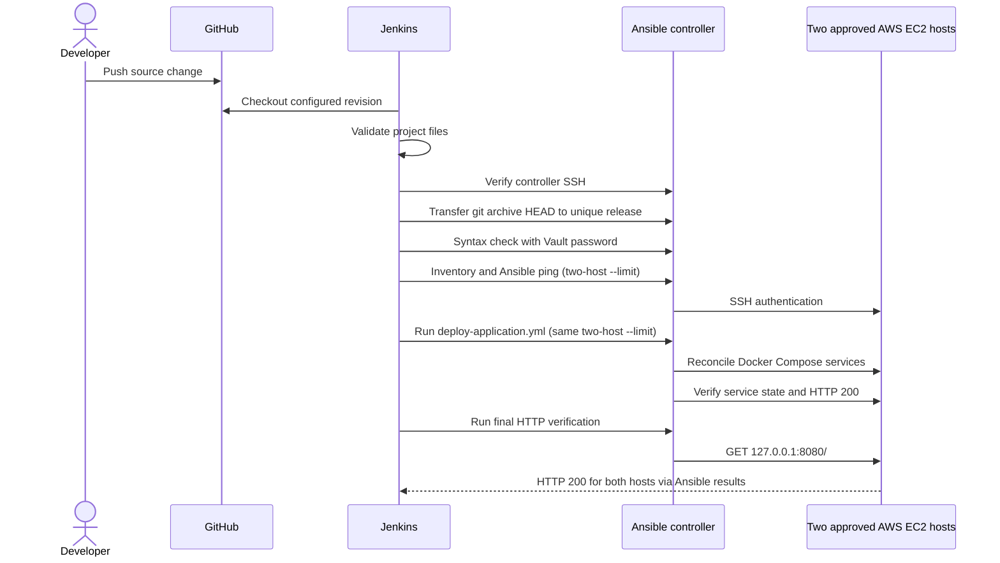

# CI/CD Pipeline — Capstone 05

## Entry point and implementation

- `Jenkinsfile`: Declarative Pipeline, checkout, loads `jenkins/capstone05.groovy`.
- `jenkins/capstone05.groovy`: Project-local script defining `runPipeline()` and calling Jenkins Pipeline steps.
- `ansible/deploy-application.yml`: Existing-application deployment and health check.
- `ansible/deploy-docker-new-user.yaml`: Separate initial provisioning playbook.

The Groovy module is loaded with Jenkins `load`; this project does **not** register a global Jenkins Shared Library.

## Execution sequence



## Stage descriptions

| Stage | Check/action | Can change application? |
| --- | --- | --- |
| Checkout | Obtain configured branch SHA | No |
| Validate Source | Assert expected files and no Vault plaintext | No |
| Verify Ansible Controller | SSH and Ansible version | No |
| Transfer Versioned Release | Upload archive to controller | No EC2 change |
| Validate Ansible Release | Ansible syntax check | No |
| Verify EC2 Connectivity | Ansible `ping` to both approved targets | No application change |
| Deploy Application | `ansible-playbook deploy-application.yml` | **Yes** |
| Verify Application HTTP | Remote `ansible.builtin.uri` with expected status 200 | No |

## Versioned release layout

```text
/root/twn-capstone-05/releases/<git-sha>-<jenkins-build>/
├── REVISION
└── ansible/
    ├── deploy-application.yml
    ├── inventory_aws_ec2.yaml
    ├── ec2-docker-vars.yaml
    ├── roles/
    └── secrets.vault.yml -> /root/secrets.vault.yml
```

The archive represents the checked-out Git tree. The Vault symlink points to a separately maintained controller-side secret and is not itself part of the archive.

## Connection requirements

For EC2 commands, the module explicitly configures:
- `ANSIBLE_HOST_KEY_CHECKING=True`
- `ANSIBLE_PRIVATE_KEY_FILE=/root/ansible-jenkins-key-pair.pem`
- `ANSIBLE_REMOTE_USER=ec2-user`
- `ANSIBLE_SSH_ARGS` with `StrictHostKeyChecking=yes`, `IdentitiesOnly=yes` and the dedicated trusted `known_hosts`.

The Ansible controller uses `amazon.aws 7.2.0`, so the inventory's custom group expression uses `tags.Role`.

## Automated deployment behavior

There is **no manual Jenkins `input()` gate**. Triggering the trusted job automatically executes the deployment when earlier checks succeed. Protect job/branch permissions. Ansible's Compose role uses `remove_orphans: true`; the role can recreate affected containers if the manifest or environment changes.

## Evidence

Build #7 (22 October 2026; **one host only**), revision `0e91d7aabd9cd1d6a79729cd5279dbe97b379e0f`: Jenkins finished `SUCCESS`, and the application HTTP verification returned 200. The complete play recap has not been supplied in the shared evidence excerpt.

See [Validation](validation.md) and [Operations](operations.md).

## Two-instance TWN validation (proposed; not yet executed through Jenkins)

The feature branch `feat/cap05-two-ec2-jenkins-targets` changes the fixed Ansible host limit in `jenkins/capstone05.groovy` from one EC2 host to **two explicitly verified** EC2 DNS names. Jenkins `Verify EC2 Connectivity`, `Deploy Application`, and `Verify Application HTTP` use the *same* limit. This aligns the pipeline with the TWN two-EC2 exercise without modifying inventory, roles, credentials or provisioning.

On 25 October 2026, the Ansible controller's dynamic inventory listed both hosts in `ec2_docker_server`; `ansible.builtin.ping` succeeded (`changed: false`, `pong`) for each, and `ansible.builtin.uri` returned HTTP 200 from `127.0.0.1:8080` on each (`OK (215 bytes)`). **These were controller-side read-only checks, not a two-host Jenkins deployment.**

**Before running Jenkins on this branch:** confirm both currently active EC2 hosts belong to this disposable training application, capture backup/recovery state, review the Docker Compose role's `remove_orphans` behavior, confirm the correct Vault credential and Jenkins job branch, and deliberately authorize changes on **both** instances. Jenkins deploy is not read-only and will reconcile Compose services on each host. Never trigger automatically simply to gather evidence.

After a successful two-host build, archive a **sanitized** full `PLAY RECAP` identifying both hosts with `failed=0` and `unreachable=0`, the Jenkins job/build/revision, and an HTTP 200 result for each host. Without that output, two-host Jenkins deployment remains **unverified**.
